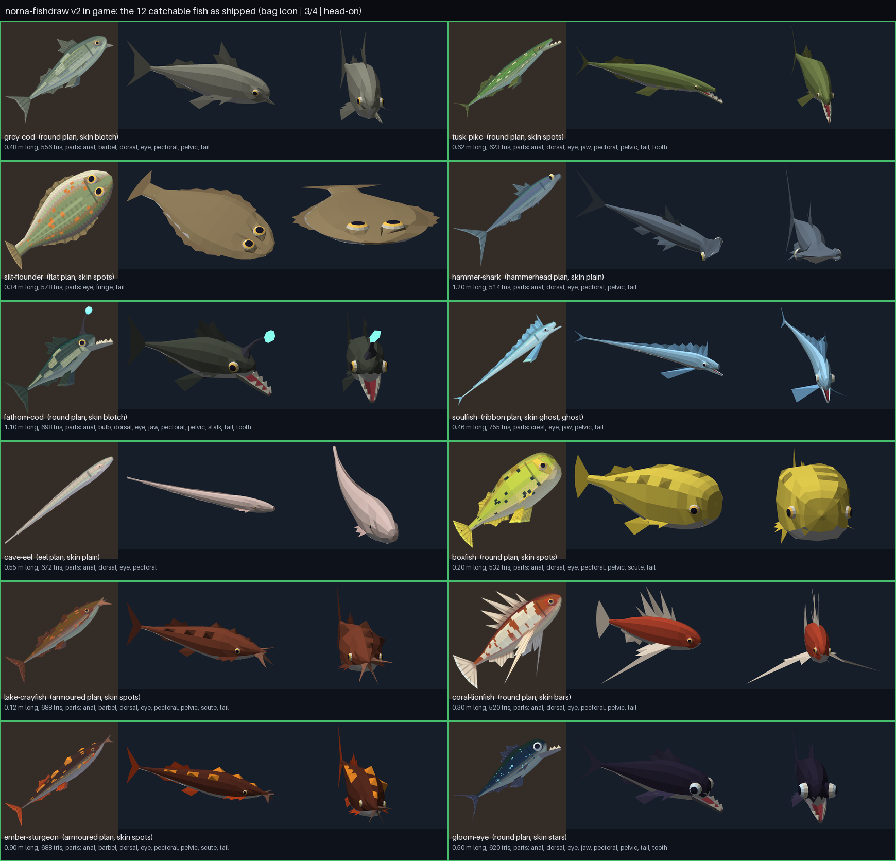
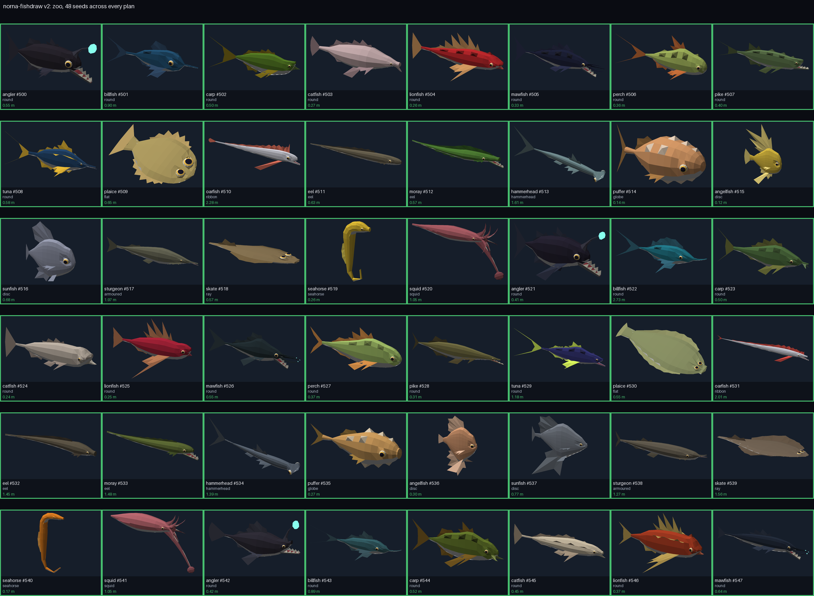

# norna-fishdraw

Procedural low-poly fish, in 3D, as rigged and textured glTF files. Pure Python, no numpy, no Blender, no GPU.

This is a fork of [fishdraw](https://github.com/LingDong-/fishdraw) by Lingdong Huang, the JavaScript
generator that draws a different plotter-style fish for every seed. It was built for
[Norna](https://norna.fun), a cosy fishing game, where every catchable species is one of these fish.
Everything here is free to use under the MIT licence, upstream's and ours.



## What is in the fork

**v1: the port and the lift** (`norna_fishdraw/`)

- `fishdraw_port.py` ports fishdraw to Python. Seeded parameters and the body and head curves are
  bit-identical to the JS. Fins keep the JS maths; the plotter hatching, scale meshes and clipper are
  replaced rather than ported, because the target is a mesh, not a drawing.
- `lift3d.py` lofts the 2D silhouette into a mesh: elliptical rings along the spine, double-sided fin
  strips, eyes, under 600 triangles, in metres, nose along +Z and back along +Y.
- `skin.py` paints a 64x32 pixel-art body texture (palette ramp, bars, blotches, spots, stars or a glow
  band, lateral line, a scale grid) and a 32x16 fin texture with the standard library alone.
- `glb_writer.py` writes a binary glTF with the textures embedded. Output is quantised so every platform
  writes the same bytes.
- `presets.py` maps the game's species to parameter overrides, and `fish_for(species, seed)` makes a
  seeded individual.
- `icons.py` is a software rasteriser that renders a GLB into a 128 px inventory icon, with a manifest
  so a changed mesh makes its icon read stale.

**v2: the generator** (`norna_fishdraw/v2/`)

v2 stops lofting a drawing and builds the fish from a **genome**: a flat JSON map of body genes, part genes,
skin, palette, finish and mutations. Each gene reads its own hash sub-stream of the seed, so adding a gene
never changes any other.

- Eleven body plans (`plans.py`): round, flat, ribbon, eel, hammerhead, globe, disc, armoured, ray,
  seahorse, squid. Twenty-one archetype species cover them, and ten mutations (gigantism, dwarf, fanged,
  bearded, cyclops, bigeye, winged, spined, lure, bioluminescent) scale or add whole parts.
- Parts are welded to the body by construction (`parts.py`): a fin's roots are a chain of the body's own
  lattice vertices, an eye is a dome on a socket of body vertices, tentacles and lure stalks are tubes
  rooted the same way, the jaw is lofted from a chain of belly vertices and hinges. No T-junctions, one
  connected mesh.
- A validator (`validate.py`) reads triangles only and rejects anything welded wrong, pierced, floating,
  inside-out, degenerate, over budget or out of proportion. `build.make` is fail-closed: a seed whose
  mutation breaks a check is retried at lower gene strength and ends as the plain species if it must.
  `fixtures.py` reproduces every known break on purpose so each check is proven live.
- A rig (`rig.py`): spine bones, a jaw bone, a bone chain down every tentacle, four weights a vertex.
  `motion.py` is the runtime table (body wave by plan, tentacles as a lagging spring chain, jaw gape),
  and a motion validator poses every extreme and re-checks the mesh.
- `glb.py` writes a skinned binary glTF: per-role materials, clearcoat eyes, sheen, iridescence,
  `KHR_materials_emissive_strength` for bioluminescence, two-sided thin parts, a node pose. 50 to 100 KB
  a fish.
- `skin2.py` carries v1's pixel art onto the lattice UVs and adds five more pattern families;
  `finish.py` has the shiny, shimmer, pearl, holographic and ghost finishes.
- `game.py` and `game2.py` pin the 110 catchable species of Norna as genomes; `bake.py --game` writes
  them all, byte-stably, with a `fish.json` manifest carrying each rig for a game client to read.
- `sweep.py` runs 500 seeds through everything; `variety.py` and `distinct.py` measure silhouette overlap
  so two seeds, or two species, never look alike; `sheet.py` paints contact sheets like the one above.



## Quick start

```sh
git clone https://github.com/albinekb/norna-fishdraw
cd norna-fishdraw
pip install pillow          # optional: icons, contact sheets and the v1-vs-v2 compare need it

python3 norna_fishdraw/v2/bake.py --game        # out/fish/<slug>.glb + .calibrate.json + fish.json, 110 fish
python3 norna_fishdraw/v2/bake.py               # out/s2: a glowing angler and oarfish, with and without the glow
python3 norna_fishdraw/icons.py                 # out/icons/<slug>.webp from out/fish, plus a freshness manifest
python3 norna_fishdraw/v2/sheet.py              # out/sheets: plan sheet, variety sheets, the zoo
python3 norna_fishdraw/v2/sheet.py --game docs/mine.png --only grey-cod,soulfish
python3 norna_fishdraw/build.py                 # out/v1: the original lofted v1 fish
```

Any seed, any species, from Python:

```python
import sys; sys.path.insert(0, ".")
from norna_fishdraw.v2 import genome as G, glb as GLB, rig as RG
from norna_fishdraw.v2.build import make

fish = make("angler", 42, ["bioluminescent"])        # validated, or retried weaker, never broken
genome = G.draw("angler", 42, ["bioluminescent"])     # the same fish as a flat, JSON-able dict
GLB.write_glb("angler-42.glb", fish, RG.build_rig(fish), "angler")   # a skinned, textured binary glTF
```

Species names for `make` and `draw` are the v2 archetypes (`genome.SPECIES`: angler, billfish, carp,
catfish, eel, hammerhead, lionfish, mawfish, moray, oarfish, perch, pike, plaice, puffer, seahorse, skate,
squid, sturgeon, sunfish, tuna, angelfish) or any of Norna's 110 slugs (`v2/game.py`, `v2/game2.py`).

## Tests

```sh
python3 norna_fishdraw/test_fishdraw.py     # ~30 s: port parity, determinism across hash seeds, GLB stability, icons
python3 norna_fishdraw/v2/test_v2.py        # ~30 s: every plan builds, weld, validator vs every known break,
                                            #        rig and motion extremes, variety, the 500-seed sweep, pinned vectors
```

Both bake the full game set into a temp directory first. `v2/vectors.json` and `v2/motion-vectors.json`
pin genomes, mesh hashes and bone poses; regenerate them on purpose with `python3 norna_fishdraw/v2/vectors.py --write`.

## Coordinates and conventions

Metres. Nose along +Z, back along +Y, left flank along +X. Body UVs are a planar side view shared by both
flanks (u nose to tail, v back to belly). Flat plans are baked lying down with their catalogue pose on a root
node above mesh and skeleton, since glTF ignores a skinned node's own transform. Every writer quantises
coordinates, normals and UVs to 1e-5 and folds -0.0 to 0.0, so Linux and macOS agree byte for byte.

## Credits and licence

Lingdong Huang made [fishdraw](https://github.com/LingDong-/fishdraw) (MIT, 2021); the shape language, the
seeded parameter space and the body and head curves are his. The Python port, the 3D lift, the v2 genome,
parts kit, validator, rig and glTF writers were written for Norna in 2026. MIT, see [LICENSE](LICENSE);
upstream's original notice is kept in `norna_fishdraw/LICENSE.fishdraw`.
